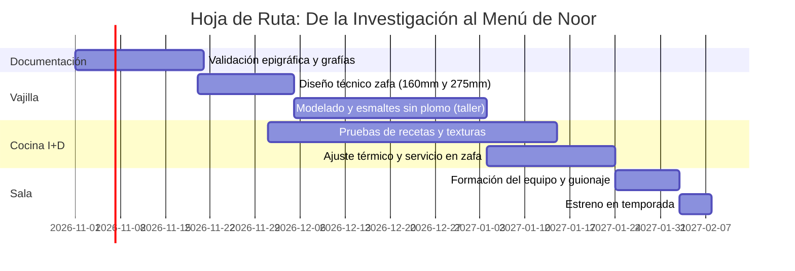

# ¡COME! · كُلْ
## Representación del Arte Epigráfico de las Zafas del Siglo XI en la Mesa de Noor
**Dossier Didáctico y Propuesta Gastronómica para la Gerencia de Restaurante Noor (Córdoba)**  
*Autor: Leonardo Gallardo Apolo* · *Octubre de 2026*  
*Documento de Trabajo e Investigación Aplicada*

---

## 1. Resumen Ejecutivo

Este proyecto traslada a la mesa de **Noor** uno de los hallazgos epigráficos y cerámicos más singulares de la arqueología andalusí: la serie **«¡Come!» (*Kul*)** del siglo XI, documentada y sistematizada en el estudio de Pau Armengol y Carmen Barceló (*Boletín de Arqueología Medieval*, 2024).

Frente a la cerámica califal cordobesa habitual —que portaba fórmulas propiciatorias abstractas de poder y dicha (*al-mulk*, *baraka*, *yumn*)—, las zafas de esta serie presentan una orden directa, funcional y gastronómica escrita en el fondo del recipiente: el imperativo árabe **كُلْ (*kul*, «¡come!»)** acompañado del nombre del guiso servido (*baqliyya*, *qarʿiyya*, *ŷulaydiyya*, *gassāniyya*).

Proponemos una experiencia en **cuatro pases de degustación** servidos en recreaciones artesanales de zafas andalusíes en verde y manganeso sobre blanco de estaño. El comensal recibe el plato cubierto por el guiso y, a medida que consume la preparación, **descubre en el fondo la inscripción en cúfico foliado que revela exactamente lo que acaba de comer**.

```
[ GESTO HISTÓRICO ]                     [ EXPERIENCIA NOOR ]
Cerámica con mandato directo (s. XI)  ──>  El comensal degusta el guiso
Zafa con fondo oculto por el alimento ──>  Al terminar, el fondo queda limpio
Epígrafe: kul + nombre del manjar     ──>  Se descubre la inscripción caligráfica
```

---

## 2. Marco Arqueológico e Histórico

### 2.1 El corpus de la serie «¡Come!»
* **40 ejemplares catalogados:** La mayoría hallados en excavaciones de la ciudad de València y su área periurbana (Benetússer, Silla), con apariciones en Dénia, El Castellar d’Alcoi, La Vila Joiosa, Albarracín, Toledo, Mértola (Portugal) y la Alcazaba de Málaga.
* **Cronología:** Segunda mitad del siglo XI (época de las Taifas), coincidente paleográficamente con inscripciones lapidarias valencianas (epitafio de Sīd Būna, 1061) y dírhams de al-Ma'mūn (1063–1075).
* **Función social:** Vasijas de presentación colectiva para banquetes extraordinarios (fiestas de ruptura del ayuno *ʿīd al-fiṭr*, sacrificios *ʿīd al-aḍḥà*, celebraciones familiares). Capacidad original de 2 a 3 kg para 6 a 12 comensales.

### 2.2 Evolución del discurso epigráfico en la vajilla

| Período / Serie | Tipología de Mensaje | Fórmulas Documentadas | Sentido en la Mesa |
|---|---|---|---|
| **Califal (s. X, Córdoba)** | Voto propiciatorio / político | *al-mulk* (el poder), *baraka* (bendición), *yumn* (dicha) | Deseo de soberanía o bienestar dinástico; desvinculado del alimento. |
| **Califal / Taifa (s. X–XI)** | Fórmulas de confianza | *tawakkal* («confía»), *tawakkal tukfà* («confía, te bastará») | Piedad religiosa y mesura ante el sustento. |
| **Serie «¡Come!» (s. XI, Taifas)** | **Mandato culinario directo** | ***kul* + nombre del guiso** (*kul baqliyya*, *kul qarʿiyya*, etc.) | **Interacción directa vasija-comensal: ordena comer y describe el contenido.** |

---

## 3. Especificaciones Técnicas de la Zafa de Noor

Para adaptar la vasija histórica a la alta cocina actual sin desvirtuar su proporción ni su morfología arqueológica, se plantean dos formatos:

### 3.1 Morfología y Dimensiones
* **Forma:** Zafa (*ṣaḥfa*), cuenco semiesférico de base anular, paredes curvadas continuas y borde ligeramente engrosado al exterior.
* **Talla Pase (Menú Degustación):**
  * Diámetro de boca: **160 mm**
  * Altura total: **60 mm**
  * Capacidad útil: **120–150 ml / g** (perfecta para un pase individual de guiso concentrado).
* **Talla Banquete (Pase Compartido al Centro):**
  * Diámetro de boca: **275 mm** (dimensión canónica del s. XI)
  * Altura total: **120 mm**
  * Capacidad útil: **1,2 a 1,8 kg** (para mesas de 4 a 8 comensales).

### 3.2 Alfarería, Vidriado y Caligrafía
1. **Pasta:** Arcilla decantada cocida a media-alta temperatura (1020 °C) para garantizar resistencia mecánica y estanqueidad térmica.
2. **Esmalte interior:** Vidriado blanco de estaño (*tin-opacified glaze*), brillante, no poroso, que impide la fijación de grasas y salsas.
3. **Seguridad Alimentaria:** Formulación de esmalte y pigmentos **100% exenta de plomo y cadmio**, con ensayo de lixiviación homologado conforme al Reglamento (CE) n.º 1935/2004.
4. **Decoración:** Pintada a mano por artesano calígrafo:
   * **Perfil de las letras:** Óxido de manganeso (marrón oscuro casi negro).
   * **Relleno interior:** Óxido de cobre (verde esmeralda andalusí).
   * **Ornatos:** Ovas perimetrales y motivos vegetales de dos y tres brotes extraídos de la Fig. 5 de Armengol y Barceló (2024).

---

## 4. La Propuesta Gastronómica: 4 Pases de Temporada

Los cuatro pases toman como raíz los cuatro guisos atestiguados en las zafas originales, cruzados con los grandes recetarios andalusíes (*Ibn Razīn al-Tuŷībī* y el *Anónimo Almohade* del siglo XIII):

```
                        SERIE «¡COME!» EN NOOR
                                  │
       ┌──────────────────┬───────┴──────────┬──────────────────┐
       ▼                  ▼                  ▼                  ▼
    PASE I             PASE II            PASE III           PASE IV
«¡Come la           «¡Come la          «¡Come la          «¡Come el
berenjena!»         calabaza!»         almendra!»         azafrán!»
[Baqliyya]         [Qarʿiyya]         [Ŷulaydiyya]       [Gassāniyya]
```

---

### Pase I · «¡Come la berenjena!» (*Kul al-bāḏinŷān* · كل الباذنجان)
* **Raíz histórica:** *Baqliyya* (guiso de verduras). La receta del anónimo almohade atribuida al músico y gastrónomo Ziryāb combina carne de cordero con hortalizas tiernas, alcaravea y cobertura de almendra.
* **Interpretación Noor:** Berenjena tierna asada al sarmiento y glaseada en un jugo tostado de cordero lechal con alcaravea, cilantro fresco y gotas de vinagre de Jerez añejo. Se corona con una película crujiente de pan deshidratado y almendra marcona.
* **Momento epigráfico:** Al rebañar el jugo, el fondo blanco de estaño desvela la caligrafía verde: **كل الباذنجان**.

---

### Pase II · «¡Come la calabaza!» (*Kul al-qarʿ* · كل القرع)
* **Raíz histórica:** *Qarʿiyya* (guiso de calabaza). Citada por Ibn Razīn y prescrita por el médico Ibn al-Jaṭīb para convalecientes por sus virtudes digestivas.
* **Atención al ingrediente:** El *qarʿ* andalusí es la calabaza de cuello o vinatera (*Lagenaria siceraria*). Las calabazas redondas o violín de pulpa naranja son americanas (*Cucurbita*) y quedan terminantemente excluidas.
* **Interpretación Noor:** Finas láminas de calabaza *Lagenaria* confitadas lentamente en grasa de cordero y hierbas silvestres (orégano de monte y tomillo andalusí). Fondo untuoso y concentrado con emulsión de cilantro y aceite de oliva virgen extra de Jaén/Córdoba.
* **Momento epigráfico:** La última lámina de calabaza deja a la vista: **كل القرع**.

---

### Pase III · «¡Come la almendra!» (*Kul al-lawz* · كل اللوز)
* **Raíz histórica:** *Ŷulaydiyya* («el encostradito», derivado de *ŷild*, piel o costra). Guiso palatino de ave cubierto por una costra dorada de almendras molidas, nueces, pan rallado, canela y yemas.
* **Interpretación Noor:** Pichón o capón desmigado con fondo especiado de canela, galanga, pasas y piñones tostados, horneado bajo una costra finísima y quebradiza de almendra y azafrán.
* **Momento epigráfico:** El comensal quiebra la costra con la cuchara y, al vaciar el fondo, surge la orden: **كل اللوز**.

---

### Pase IV · «¡Come el azafrán!» (*Kul al-zaʿfarān* · كل الزعفران)
* **Raíz histórica:** *Gassāniyya* (guiso del cocinero al-Gassānī). Preparación festiva con carne, sémola, miel, azafrán, canela y adorno de huevos partidos, precursora de las transiciones dulce-saladas andalusíes.
* **Interpretación Noor:** Pase de bisagra hacia los postres. Sémola ligera suflada e hidratada en una infusión de azafrán puro y miel de azahar, acompañada de un helado salino de almendra amarga y yema curada en almíbar de canela.
* **Momento epigráfico:** El amarillo azafranado del plato da paso al fondo de la zafa: **كل الزعفران**.

---

## 5. El Discurso de Sala (Guion de Servicio)

El relato ante el comensal debe ser conciso, elegante y riguroso, evitando lecciones magistrales y centrando la atención en el objeto y el acto de comer:

```
PASO 1: EN EL SERVICIO (15 segundos)
«Presentamos este plato en una zafa, la fuente de banquete de al-Andalus.
 En el siglo XI, los maestros alfareros escribían en su fondo una orden directa:
 "Kul", que significa "¡come!", acompañada del nombre del guiso.
 Les invitamos a disfrutarla y descubrir el mandato de la pieza.»

                        │
                        ▼  (Degustación)
                        │

PASO 2: AL RETIRAR O REBAÑAR (15 segundos)
«En el fondo acaban de descubrir la inscripción "Kul al-bāḏinŷān":
 "¡Come la berenjena!". Es nuestro homenaje a las recetas de la Taifa de
 València que ya en el año 1060 nombraban en el barro lo que se servía en la mesa.»
```

---

## 6. Despensa Andaluza: Tabla de Rigor Histórico

Para salvaguardar la coherencia histórica que caracteriza a Noor, el proyecto incluye un filtro estricto de ingredientes:

| Ingrediente | Veredicto | Justificación Histórica / Documental |
|---|---|---|
| **Berenjena (*bāḏinŷān*)** | **AUTORIZADO** | Introducida en el siglo VIII por Oriente; protagonista en recetarios andalusíes. |
| **Tomate** | **PROHIBIDO** | Origen americano (llegada posterior a 1492). |
| **Calabaza vinatera (*Lagenaria*)** | **AUTORIZADO** | La calabaza del Viejo Mundo (*qarʿ*); carne blanca o verdosa clara. |
| **Calabaza naranja (*Cucurbita*)** | **PROHIBIDO** | Origen mesoamericano; inexistente en época medieval. |
| **Almendra marcona** | **AUTORIZADO** | Base estructural de salsas, coberturas (*ŷulaydiyya*) y ligazones. |
| **Patata** | **PROHIBIDO** | Tubérculo andino introducido en el siglo XVI. |
| **Azafrán (*zaʿfarān*)** | **AUTORIZADO** | Cultivado extensamente en al-Andalus; colorante y aromatizante rey. |
| **Pimentón** | **PROHIBIDO** | Derivado del pimiento americano. |
| **Naranja amarga (*nāranŷ*)** | **AUTORIZADO** | La variedad presente en el siglo XI; la naranja dulce se introdujo mucho después. |
| **Almorí (*al-murrī*)** | **AUTORIZADO** | Condimento líquido fermentado de harina de cebada tostada y especias. |
| **Canela, galanga y alcaravea** | **AUTORIZADO** | Especias de la ruta comercial de Oriente plenamente integradas en Córdoba. |

---

## 7. Plan de Trabajo e Implementación



1. **Fase 1 · Validación epigráfica:** Contraste de las caligrafías propuestas con documentalistas y arabistas colaboradores de Noor.
2. **Fase 2 · Prototipado cerámico:** Encargo a un alfar tradicional (Córdoba / La Rambla / Úbeda) de dos juegos de prueba de zafas de 160 mm y 275 mm con análisis toxicológico CE.
3. **Fase 3 · Ensayos en Cocina I+D:** Ajuste de salsas y coberturas para asegurar que el fondo se limpie de manera natural con el cubierto o el pan.
4. **Fase 4 · Guion de Sala:** Capacitación del equipo de sala para transmitir el relato en 30 segundos.
5. **Fase 5 · Inclusión en Carta:** Lanzamiento como pase secuencial en el menú degustación temático.

---

## 8. Materiales Entregados en esta Carpeta

* `index.html`: **Maquetación interactiva completa**, visualizable en navegador o pantalla táctil, con simulación de raspado del guiso en zafas dinámicas, despiece arqueológico SVG, selector de despensa interactivo y estilos optimizados para impresión en PDF/folio.
* `Dossier_Propuesta_Gerencia_Noor.md`: Este informe ejecutivo para archivo y lectura técnica.
* Artículos y bibliografía de soporte: Ubicados en la carpeta contigua `../01_Articulos_PDF/`.

---
*Córdoba / València, Octubre de 2026.*
