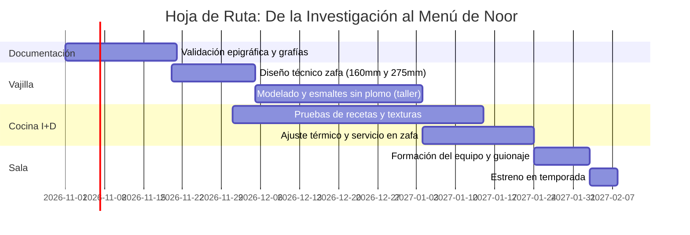

# ¡COME! · كُلْ
## Representación del Arte Epigráfico de las Zafas del Siglo XI en la Mesa de Noor
**Dossier Didáctico y Propuesta Gastronómica para Restaurante Noor (Córdoba)**  
*Autoría y concepto: Restaurante Noor · Dirección y supervisión: Paco Morales y Paola Gualandi* · *Octubre de 2026*  
*Documento de Trabajo e Investigación Aplicada*

---

## 1. Resumen Ejecutivo

Este proyecto formula una propuesta conceptual, gastronómica y de vajilla para la mesa de **Noor**, bajo la dirección y supervisión de **Paco Morales** y **Paola Gualandi**, trasladando a la experiencia gastronómica uno de los hallazgos epigráficos y cerámicos más singulares de la arqueología andalusí: la serie **«¡Come!» (*Kul*)** del siglo XI, documentada y sistematizada en el estudio de Pau Armengol y Carmen Barceló (*Boletín de Arqueología Medieval*, 2024).

Frente a la cerámica califal cordobesa habitual —que portaba fórmulas propiciatorias abstractas de poder y dicha (*al-mulk*, *baraka*, *yumn*)—, las zafas de esta serie presentan una orden directa, funcional y gastronómica escrita en el fondo del recipiente: el imperativo árabe **كُلْ (*kul*, «¡come!»)** acompañado del nombre del guiso servido (*baqliyya*, *qarʿiyya*, *ŷulaydiyya*, *gassāniyya*).

Proponemos una experiencia en **cuatro pases de degustación** servidos en recreaciones artesanales de zafas andalusíes en verde y manganeso sobre blanco de estaño. El comensal recibe el plato cubierto por el guiso y, a medida que consume la preparación, **descubre en el fondo la inscripción en cúfico foliado que revela exactamente lo que acaba de comer**.

```
[ GESTO HISTÓRICO ]                     [ EXPERIENCIA NOOR ]
Cerámica con mandato directo (s. XI)  ──>  El comensal degusta el guiso
Zafa con fondo oculto por el alimento ──>  Al terminar, el fondo queda limpio
Epígrafe: kul + nombre del manjar     ──>  Se descubre la inscripción caligráfica
```

---

## 2. Marco Arqueológico e Histórico

### 2.1 El corpus de la serie «¡Come!»
* **40 ejemplares catalogados:** La mayoría hallados en excavaciones de la ciudad de València y su área periurbana (Benetússer, Silla), con apariciones en Dénia, El Castellar d’Alcoi, La Vila Joiosa, Albarracín, Toledo, Mértola (Portugal) y la Alcazaba de Málaga.
* **Cronología:** Segunda mitad del siglo XI (época de las Taifas), coincidente paleográficamente con inscripciones lapidarias valencianas (epitafio de Sīd Būna, 1061) y dírhams de al-Ma'mūn (1063–1075).
* **Función social:** Vasijas de presentación colectiva para banquetes extraordinarios (fiestas de ruptura del ayuno *ʿīd al-fiṭr*, sacrificios *ʿīd al-aḍḥà*, celebraciones familiares). Capacidad original de 2 a 3 kg para 6 a 12 comensales.

### 2.2 Evolución del discurso epigráfico en la vajilla

| Período / Serie | Tipología de Mensaje | Fórmulas Documentadas | Sentido en la Mesa |
|---|---|---|---|
| **Califal (s. X, Córdoba)** | Voto propiciatorio / político | *al-mulk* (el poder), *baraka* (bendición), *yumn* (dicha) | Deseo de soberanía o bienestar dinástico; desvinculado del alimento. |
| **Califal / Taifa (s. X–XI)** | Fórmulas de confianza | *tawakkal* («confía»), *tawakkal tukfà* («confía, te bastará») | Piedad religiosa y mesura ante el sustento. |
| **Serie «¡Come!» (s. XI, Taifas)** | **Mandato culinario directo** | ***kul* + nombre del guiso** (*kul baqliyya*, *kul qarʿiyya*, etc.) | **Interacción directa vasija-comensal: ordena comer y describe el contenido.** |

---

## 3. Especificaciones Técnicas de la Zafa de Noor

Para adaptar la vasija histórica a la alta cocina actual sin desvirtuar su proporción ni su morfología arqueológica, se plantean dos formatos:

### 3.1 Morfología y Dimensiones
* **Forma:** Zafa (*ṣaḥfa*), cuenco semiesférico de base anular, paredes curvadas continuas y borde ligeramente engrosado al exterior.
* **Zafa de pase (menú degustación):**
  * Diámetro de boca: **160 mm**
  * Altura total: **60 mm**
  * Capacidad útil: **120–150 ml / g** (un pase individual de guiso concentrado).
* **Zafa de mesa (pase compartido al centro):**
  * Diámetro de boca: **275 mm**, dentro del rango de la serie (250–300 mm; los diámetros más frecuentes, entre 254 y 275 mm)
  * Altura total: **120 mm**
  * Capacidad: las zafas originales admitían **2 a 3 kg para 6 a 12 comensales**; en Noor, **1,2 a 1,8 kg por servicio para 4 a 8**.

### 3.2 Alfarería, Vidriado y Caligrafía
1. **Pasta:** Arcilla decantada cocida a media-alta temperatura (1020 °C) para garantizar resistencia mecánica y estanqueidad térmica.
2. **Esmalte interior:** Vidriado blanco de estaño (*tin-opacified glaze*), brillante, no poroso, que impide la fijación de grasas y salsas.
3. **Seguridad Alimentaria:** Formulación de esmalte y pigmentos **100% exenta de plomo y cadmio**, con ensayo de lixiviación homologado conforme al Reglamento (CE) n.º 1935/2004.
4. **Decoración:** Pintada a mano por artesano calígrafo:
   * **Perfil de las letras:** Óxido de manganeso (marrón oscuro casi negro).
   * **Relleno interior:** Óxido de cobre (verde esmeralda andalusí).
   * **Ornatos:** Ovas perimetrales y motivos vegetales de dos y tres brotes extraídos de la Fig. 5 de Armengol y Barceló (2024).

---

## 4. La Propuesta Gastronómica: 4 Pases de Temporada

Los cuatro pases toman como raíz los cuatro guisos atestiguados en las zafas originales, cruzados con los grandes recetarios andalusíes (*Ibn Razīn al-Tuŷībī* y el *Anónimo Almohade* del siglo XIII):

```
                        SERIE «¡COME!» EN NOOR
                                  │
       ┌──────────────────┬───────┴──────────┬──────────────────┐
       ▼                  ▼                  ▼                  ▼
    PASE I             PASE II            PASE III           PASE IV
«¡Come la           «¡Come la          «¡Come la          «¡Come el
berenjena!»         calabaza!»         almendra!»         azafrán!»
[Baqliyya]         [Qarʿiyya]         [Ŷulaydiyya]       [Gassāniyya]
```

---

### Pase I · «¡Come la berenjena!» (*Kul al-bāḏinŷān* · كل الباذنجان)
* **Raíz histórica:** *Baqliyya* (guiso de verduras). La receta del anónimo almohade atribuida al músico y gastrónomo Ziryāb lleva cordero, coliflor, cebolla, cilantro, alcaravea y pimienta, con una cobertura de almendra, huevo y pan. Otra versión admite berenjena.
* **Interpretación Noor:** La berenjena ocupa el lugar de la coliflor. Berenjena asada a la brasa y bañada con el jugo del guiso de cordero, cilantro y alcaravea. La cobertura de almendra, huevo y pan se convierte en una costra fina y crujiente.
* **Ingrediente de vanguardia: alcaparra (hoja, brote y alcaparrón).** Ibn Baṣṣāl (siglo XI) la cultiva en el mismo capítulo que la berenjena y hay restos en letrinas andalusíes de los siglos X a XII (Peralta-Gómez *et al.*, 2026). Hoja y brote lactofermentados, y «sal de alcaparra» para terminar la costra.
* **Momento epigráfico:** Al terminar la berenjena, el fondo blanco de estaño desvela la caligrafía verde: **كل الباذنجان**.

---

### Pase II · «¡Come la calabaza!» (*Kul al-qarʿ* · كل القرع)
* **Raíz histórica:** *Qarʿiyya* (guiso de calabaza). Citada por Ibn Razīn y prescrita por el médico Ibn al-Jaṭīb para convalecientes por sus virtudes digestivas.
* **Atención al ingrediente:** El *qarʿ* andalusí es la calabaza de cuello o vinatera (*Lagenaria siceraria*). Las calabazas redondas o violín de pulpa naranja son americanas (*Cucurbita*) y quedan terminantemente excluidas.
* **Interpretación Noor:** Calabaza de cuello tierna en láminas finas, confitada en la grasa del cordero lechal. Caldo de cordero reducido con orégano y tomillo, y cilantro fresco al final.
* **Ingrediente de vanguardia: semilla verde de cilantro.** El cilantro ya está en la *qarʿiyya*; aquí se usa su fruto aún verde, antes de que se seque. Ibn Baṣṣāl lo cuenta entre las especias y sus frutos aparecen en letrinas de los siglos X a XII. Fresco o en salmuera ligera, sobre la calabaza confitada.
* **Momento epigráfico:** La última lámina de calabaza deja a la vista: **كل القرع**.

---

### Pase III · «¡Come la almendra!» (*Kul al-lawz* · كل اللوز)
* **Raíz histórica:** *Ŷulaydiyya* («el encostradito», derivado de *ŷild*, piel o costra). Guiso palatino de ave cubierto por una costra dorada de almendras molidas, nueces, pan rallado, canela y yemas.
* **Interpretación Noor:** Capón o gallina de corral bajo una costra de almendra, yema y pan, horneada en la propia zafa. El comensal rompe la costra en la mesa.
* **Ingrediente de vanguardia: alloza (almendra verde).** La palabra viene del árabe *allawza*, «la almendra» (RAE, *Diccionario histórico*): la misma de *kul al-lawz*. Ibn Baṣṣāl trata el almendro y su conservación. Tierna y entera en marzo y abril; encurtida el resto del año, como contrapunto ácido a la costra.
* **Momento epigráfico:** El comensal quiebra la costra con la cuchara y, al vaciar el fondo, surge la orden: **كل اللوز**.

---

### Pase IV · «¡Come el azafrán!» (*Kul al-zaʿfarān* · كل الزعفران)
* **Raíz histórica:** *Gassāniyya* (guiso del cocinero al-Gassānī). Preparación festiva con carne, sémola, miel, azafrán, canela y adorno de huevos partidos, precursora de las transiciones dulce-saladas andalusíes.
* **Interpretación Noor:** Pase de transición hacia el dulce. Sémola cocida en caldo de cordero con miel, azafrán y canela, láminas de almendra y una yema curada que recuerda los huevos partidos del banquete.
* **Ingrediente de vanguardia: tépalo de la flor del azafrán.** Ibn Baṣṣāl describe el cultivo del azafrán; hoy más del 90 % del peso de la flor se tira al sacar las hebras. Deshidratado en frío e infusionado, pone el violeta junto al oro: se come la flor entera. **Antes de servirlo hay que confirmar con AESAN si cuenta como nuevo alimento** (Reglamento (UE) 2015/2283). Alternativa sin trámite: almecina, el fruto del almez (ár. *al-mays*).
* **Momento epigráfico:** El amarillo azafranado del plato da paso al fondo de la zafa: **كل الزعفران**.
* **Nota de seguridad alimentaria:** una versión anterior de este pase llevaba helado de almendra amarga. Si se recupera, hay que controlar el ácido cianhídrico (Reglamento (CE) n.º 1334/2008) o sustituirla por alloza.

---

## 5. El Discurso de Sala (Guion de Servicio)

El relato ante el comensal debe ser conciso, elegante y riguroso, evitando lecciones magistrales y centrando la atención en el objeto y el acto de comer:

```
PASO 1: AL SERVIR (15 segundos)
«Este plato llega en una zafa, la fuente de mesa de al-Andalus. Hace mil años,
 en la València de las taifas, en el fondo de algunas zafas se escribía una orden:
 "kul", "¡come!", seguida del nombre del guiso.
 Les invitamos a hacer lo que dice la pieza.»

                        │
                        ▼  (Degustación)
                        │

PASO 2: CUANDO APARECE LA INSCRIPCIÓN (15 segundos)
«Lo que acaban de leer dice "kul al-bāḏinŷān": "¡Come la berenjena!".
 Es nuestra versión. Las zafas originales nombraban cuatro guisos; uno de ellos
 es la baqliyya, de verduras, que inspira este pase.»
```

El guion es el mismo de la presentación. No conviene dar un año exacto: el estudio fecha la serie en la segunda mitad del siglo XI, y las inscripciones *kul* + ingrediente son una propuesta de Noor, no piezas históricas.

---

## 6. Despensa Andaluza: Tabla de Rigor Histórico

Para salvaguardar la coherencia histórica que caracteriza a Noor, el proyecto incluye un filtro estricto de ingredientes:

| Ingrediente | Veredicto | Justificación Histórica / Documental |
|---|---|---|
| **Berenjena (*bāḏinŷān*)** | **AUTORIZADO** | Ya figura en el Calendario de Córdoba (961) y en el tratado agrícola de Ibn Baṣṣāl (s. XI); protagonista en los recetarios andalusíes. |
| **Tomate** | **PROHIBIDO** | Origen americano (llegada posterior a 1492). |
| **Calabaza vinatera (*Lagenaria*)** | **AUTORIZADO** | La calabaza del Viejo Mundo (*qarʿ*); carne blanca o verdosa clara. |
| **Calabaza naranja (*Cucurbita*)** | **PROHIBIDO** | Origen mesoamericano; inexistente en época medieval. |
| **Almendra marcona** | **AUTORIZADO** | Base estructural de salsas, coberturas (*ŷulaydiyya*) y ligazones. |
| **Patata** | **PROHIBIDO** | Tubérculo andino introducido en el siglo XVI. |
| **Azafrán (*zaʿfarān*)** | **AUTORIZADO** | Ibn Baṣṣāl describe su cultivo (s. XI); colorante y aromatizante rey. |
| **Pimentón** | **PROHIBIDO** | Derivado del pimiento americano. |
| **Naranja amarga (*nāranŷ*)** | **AUTORIZADO** | La variedad presente en el siglo XI; la naranja dulce se introdujo mucho después. |
| **Almorí (*al-murrī*)** | **AUTORIZADO** | Condimento fermentado de masa de cebada, sal y especias, con recetas en los recetarios del s. XIII (Waines, 1991, «Murrī: the tale of a condiment», *Al-Qanṭara* 12). |
| **Canela, galanga y alcaravea** | **AUTORIZADO** | Especias de la ruta comercial de Oriente plenamente integradas en Córdoba. |

**Ingredientes de vanguardia.** Cada pase suma un ingrediente conocido en el siglo XI andalusí, poco estudiado desde la historia y en auge en la ciencia de los alimentos. Los recuentos de OpenAlex y las consultas exactas están en `bibliometria_ingredientes_openalex.csv`.

| Ingrediente | Pase | Veredicto | Justificación |
|---|---|---|---|
| **Verdolaga (*Portulaca oleracea*)** | Portada (*baqliyya*) | **AUTORIZADO** | Ibn Baṣṣāl la cultiva entre las hortalizas de hoja; comparte raíz con *baqliyya*. |
| **Alcaparra (*Capparis spinosa*)** | I · berenjena | **AUTORIZADO** | Ibn Baṣṣāl (mismo capítulo que la berenjena) y letrinas de los s. X–XII. |
| **Semilla verde de cilantro** | II · calabaza | **AUTORIZADO** | Especia de Ibn Baṣṣāl; frutos en letrinas de los s. X–XII. |
| **Alloza (almendra verde)** | III · almendra | **AUTORIZADO** | Del árabe *allawza*, «la almendra»; Ibn Baṣṣāl trata el almendro. |
| **Tépalo de la flor del azafrán** | IV · azafrán | **PENDIENTE** | Falta confirmar con AESAN si es un nuevo alimento (Reglamento (UE) 2015/2283). Alternativa: almecina. |

---

## 7. Plan de Trabajo e Implementación



1. **Fase 1 · Validación epigráfica y de ingredientes:** Contraste de las caligrafías propuestas con documentalistas y arabistas colaboradores de Noor, cotejo de los capítulos de Ibn Baṣṣāl en la edición de 1955 y consulta a AESAN sobre el tépalo de azafrán.
2. **Fase 2 · Prototipado cerámico:** Encargo a un alfar tradicional (Córdoba / La Rambla / Úbeda) de dos juegos de prueba de zafas de 160 mm y 275 mm con análisis toxicológico CE.
3. **Fase 3 · Ensayos en Cocina I+D:** Ajuste de salsas y coberturas para asegurar que el fondo se limpie de manera natural con el cubierto o el pan.
4. **Fase 4 · Guion de Sala:** Capacitación del equipo de sala para transmitir el relato en 30 segundos.
5. **Fase 5 · Inclusión en Carta:** Lanzamiento como pase secuencial en el menú degustación temático.

---

## 8. Materiales Entregados en esta Carpeta

* `index.html`: **Maquetación interactiva completa** de 16 láminas, visualizable en navegador o pantalla táctil, con simulación de raspado del guiso en zafas dinámicas, despiece arqueológico SVG, selector de despensa interactivo, lámina «Despensa de vanguardia» y estilos para impresión en PDF.
* `Dossier_Propuesta_Gerencia_Noor.md`: Este dossier técnico y gastronómico para archivo y lectura de sala y cocina.
* `../bibliometria_ingredientes_openalex.csv` y `../scripts/`: recuentos y consultas de la bibliometría de los ingredientes, y scripts para repetirla y para procesar las imágenes.
* Artículos y bibliografía de soporte: Ubicados en la carpeta contigua `../01_Articulos_PDF/`.

---
*Autoría: Restaurante Noor · Dirección y supervisión: Paco Morales y Paola Gualandi · Octubre de 2026.*
